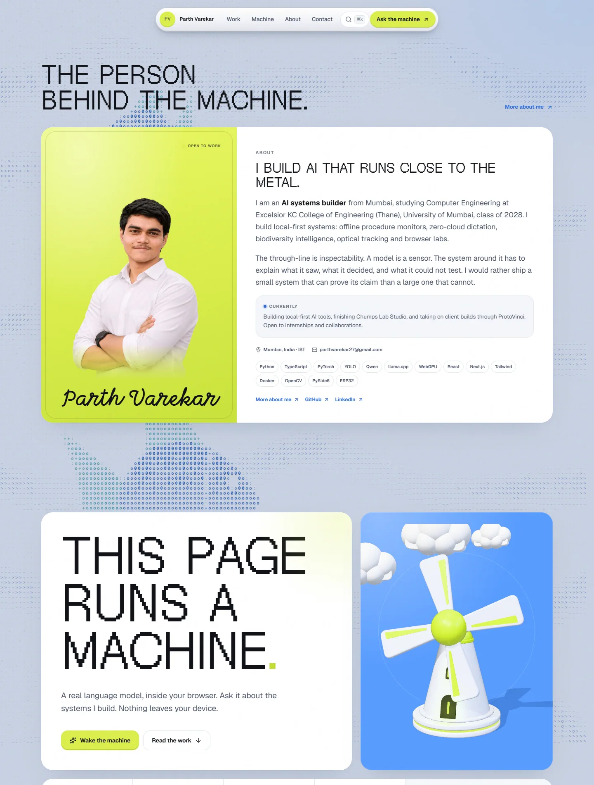
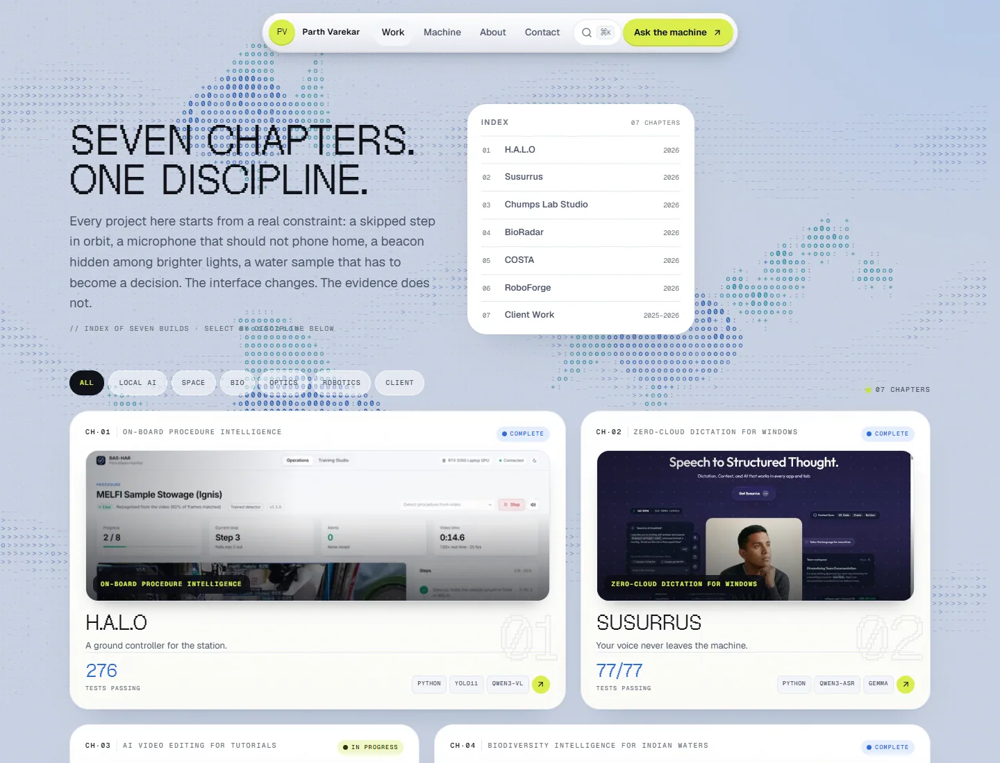
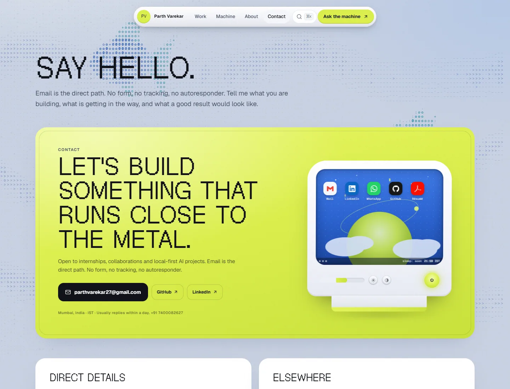
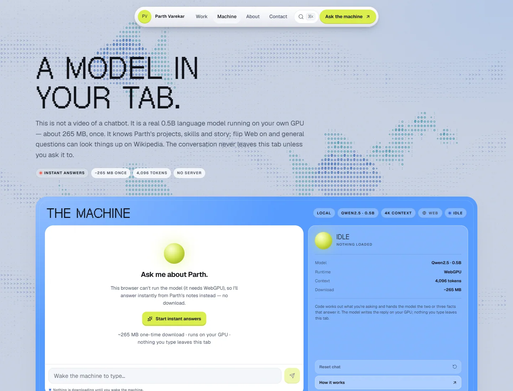
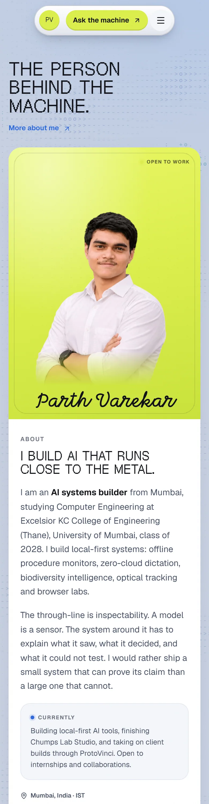

# Parth Varekar — This page runs a machine

The portfolio of **Parth Varekar**, an AI systems builder from Mumbai. The site's centrepiece is a real
language model — Qwen2.5 0.5B — running **inside the visitor's browser** on their own GPU, answering
questions about the work. Nothing typed into it leaves the tab.

<p align="center">
  
</p>

<table>
  <tr>
    <td width="50%"></td>
    <td width="50%"></td>
  </tr>
  <tr>
    <td><sub><b>The work</b> — seven chapters, each with a case study that ends in evidence.</sub></td>
    <td><sub><b>Contact</b> — a working CRT desktop: the apps open, the knobs set brightness and contrast.</sub></td>
  </tr>
  <tr>
    <td></td>
    <td align="center"></td>
  </tr>
  <tr>
    <td><sub><b>The machine</b> — shown here in a browser without WebGPU, where it falls back to instant answers.</sub></td>
    <td align="center"><sub><b>On a phone</b> — 390 px.</sub></td>
  </tr>
</table>

---

## What's in it

**The machine.** A 4-bit Qwen2.5-0.5B-Instruct model (~265 MB, downloaded once, only when the visitor
asks) runs through [WebLLM](https://github.com/mlc-ai/web-llm) and WebGPU in a Web Worker. A 0.5B model is
good at rewording a short brief and bad at working out what was asked, so the thinking is split:

- **Reflexes** in code answer what no small model should guess at — arithmetic, the date and time,
  live data, prompt-injection attempts, harmful requests, gibberish.
- **Understanding** in code works out the subject (Parth, one of his projects, this site), the detail
  being asked (results, how it works, role, education…) and follow-ups ("it", "tell me more").
- **Retrieval** hands the model the two to four fact cards that answer it — ~80 cards built from the
  same content the pages render, so the chat and the site never disagree.
- **The model** writes the reply on the visitor's GPU; cleanup keeps its words and drops only loops,
  fragments, and sentences carrying numbers or claims that aren't in the facts.
- **Web mode** (opt-in, off by default) answers world questions from Wikidata — current, exact, cited —
  and Wikipedia passages. With it off, a factual question gets a one-click "look it up" instead of a guess.
- **Without WebGPU** (most phones), the same cards answer instantly with no model at all.

**The ASCII sea.** The backdrop is an ASCII renderer: one monospace grid over the viewport, every cell's
glyph picked by the brightness of a scene painted underneath at one pixel per cell — volumetric waves of
`_ - > o`, shaded fish with fins, a wagging tail and an empty eye, a teal school that scatters from the
cursor, and a green trail of glyphs that follows the pointer and breaks up behind it. Glyphs are stamped
from a pre-rendered atlas and only changed cells are redrawn (~2 ms a frame at 1440×900).

**The rest.** A 3D windmill with drifting paper clouds (Three.js), seven case studies, a ⌘K command
palette, a retro CRT contact desk, reduced-motion support throughout. No analytics, no cookies, no chat
storage, no backend.

## Stack

Next.js 16 (App Router) · React 19 · TypeScript · Tailwind CSS 4 with hand-written tokens · WebLLM 0.2.87 ·
Three.js · MiniSearch · Geist Sans / Pixel / Mono · Lucide

## Run it

```bash
npm install
npm run dev        # http://localhost:3000
npm run build      # production build
npm run typecheck
```

The model needs a browser with WebGPU and `shader-f16` (recent Chrome or Edge on desktop). Everything else
works anywhere.

## Where things live

```
app/                 routes: /, /work, /work/[slug], /machine, /about, /contact, /colophon
components/hero/     hero card, 3D windmill, readout
components/machine/  the chat UI (model loading, streaming, instant mode)
components/shell/    nav, footer, command palette, the ASCII sea
lib/brain/           the chat's brain: reflexes, understanding, retrieval, prompt, cleanup, web lookups
lib/machine/         WebGPU detection, model id, the WebLLM worker
content/             projects, knowledge cards, résumé, site facts
wiki/                the project's working memory: decisions, progress, QA
```

`wiki/` holds the full record — every design decision with its reasoning, and a dated changelog.

---

Parth Varekar · Mumbai, India · [parthvarekar27@gmail.com](mailto:parthvarekar27@gmail.com) ·
[GitHub](https://github.com/ParthVarekar) · [LinkedIn](https://www.linkedin.com/in/parth-varekar-601432344)
